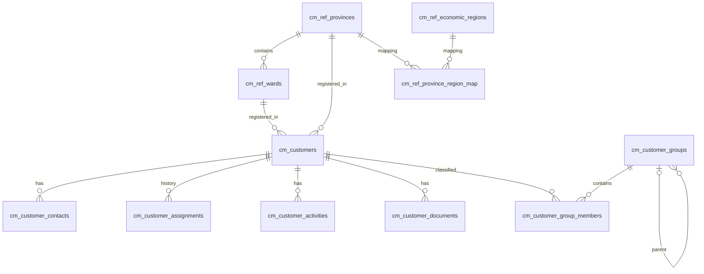

# 02 — Bảng và quan hệ

| ID | Tên tiếng Việt | Số cột | Vai trò |
|---|---|---:|---|
| cm_customers | Khách hàng | 23 | Hồ sơ, pháp lý, địa chỉ, mã KH |
| cm_customer_contacts | Người liên hệ | 12 | Nhiều liên hệ/chức vụ |
| cm_customer_groups | Nhóm khách hàng | 8 | Nhóm ngành/nhóm thị trường; phân cấp |
| cm_customer_group_members | Thành viên nhóm | 4 | Liên kết N–N |
| cm_customer_assignments | Phân công và bàn giao Sale | 11 | Lịch sử nhận/giao, 1 Sale hiện tại |
| cm_customer_activities | Công việc & nhật ký | 12 | Theo dõi tương tác và việc còn tồn |
| cm_customer_documents | Tài liệu & hiệu lực | 14 | Storage metadata, ngày ký/hiệu lực/hết hạn |
| cm_ref_provinces | Tỉnh/Thành phố | 8 | Mã hành chính 2 chữ số |
| cm_ref_wards | Phường/Xã/Đặc khu | 9 | Mã 5 chữ số và tỉnh trực thuộc |
| cm_ref_economic_regions | 6 vùng kinh tế – xã hội | 6 | Mã/nhãn vùng |
| cm_ref_province_region_map | Mapping tỉnh → vùng/miền | 7 | Ánh xạ theo phiên bản/hiệu lực |

## ERD quan hệ (sơ đồ logic)

### Quan hệ chi tiết
- 7 FK baseline giữ nguyên (`ON DELETE RESTRICT`).
- Customer → Province qua `province_code` FK nullable.
- Customer → Ward + Province qua **composite FK** `(ward_code,province_code)` → `cm_ref_wards(ward_code,province_code)`, chỉ cho phép cặp thuộc cùng tỉnh; index/UNIQUE phụ trên ward để PostgreSQL hỗ trợ FK kép.
- Ward → Province FK.
- Map → Province và Map → EconomicRegion FK.
- Account UUID chỉ tham chiếu **logic** IAM, không FK vật lý.
- Không lưu riêng `macro_region_code`/`region_code` trên Customer; suy từ Province → mapping hiện hành. Với khách nước ngoài hiển thị FOREIGN/N/A ở báo cáo.
