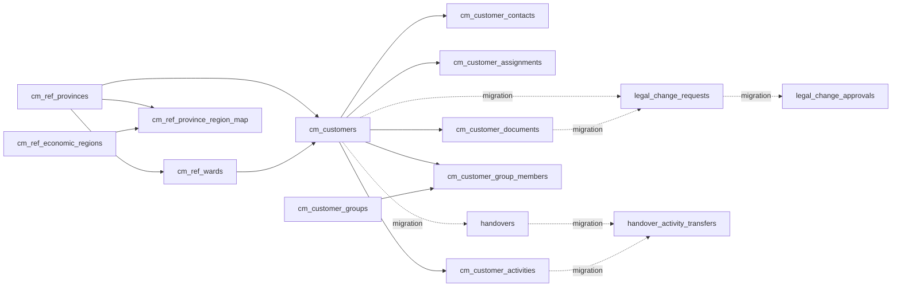

# Quan hệ dữ liệu, ràng buộc, seed và invariants

## A. Baseline 11 bảng — báo đã triển khai R2
- `cm_customers(customer_id)` là định danh UUID duy nhất cho khách hàng; `customer_code varchar(6)` là mã 6 số do sequence cấp, không cho user tự ghi.
- `cm_customer_contacts.customer_id`, `cm_customer_assignments.customer_id`, `cm_customer_activities.customer_id`, `cm_customer_documents.customer_id` tham chiếu khách hàng.
- `cm_customer_group_members` liên kết nhiều-nhiều `customers` ↔ `groups`.
- `cm_ref_wards` liên kết `cm_ref_provinces`; `customers(ward_code, province_code)` FK kép khẳng định xã đúng tỉnh.
- `cm_ref_province_region_map` liên kết tỉnh ↔ vùng kinh tế và miền; giữ nguyên seed quốc gia đã kiểm.
- `cm_customer_assignments` baseline có partial unique cho **một assignment còn hiệu lực**, bất kể vai trò — chưa hỗ trợ nhiều Sale hỗ trợ đồng thời.
- `cm_customers.customer_status_code` là trạng thái quan hệ (PROSPECT/NEW/ACTIVE/PAUSED/CLOSED), **không phải** trạng thái DRAFT/VERIFIED.
- `cm_customer_documents` lưu `signed_date/effective_date/expiry_date`, lưu metadata/đường dẫn file chứ không lưu binary trong PostgreSQL.
- DB dữ liệu nhạy cảm: role `talo_app` nhận GRANT tường minh theo cột; không suy ra từ quyền IAM.

## B. Target Backend REV01 sau migration candidate, chưa cài
- Bổ sung `cm_customers.record_status_code` = DRAFT hoặc VERIFIED; một hồ sơ quan hệ ACTIVE vẫn có thể cần kiểm về legal status.
- `cm_customer_assignments.assignment_role_code` = PRIMARY/SUPPORT; tối đa 1 PRIMARY hiệu lực và nhiều SUPPORT, nhưng không trùng Sale đang hiệu lực trên cùng customer.
- `cm_customer_documents.supersedes_document_id`: phiên bản mới trỏ đúng tài liệu trước **cùng khách hàng**, không overwrite file cũ, tối đa một successor trực tiếp.
- `cm_customer_legal_change_requests`: lưu yêu cầu + old/new snapshot, chứng từ cùng customer, chỉ một yêu cầu pending/customer.
- `cm_customer_legal_change_approvals`: quyết định ở từng stage MANAGEMENT và ACCOUNTING (UNIQUE request/stage).
- `cm_customer_handovers`: hai luồng với các bước quản lý/Sale cũ/Sale nhận, ngăn hai handover pending/customer.
- `cm_customer_handover_activity_transfers`: audit nghiệp vụ khi chuyển activity, FK kép cùng customer.
- FK `ON DELETE RESTRICT`; không cascade xóa khách hàng; phạm vi quyền DB không thay thế object-level authorization.

## ERD logic (đề xuất)

## Seed trên TEST theo báo cáo
- 34 tỉnh/thành; 3.321 xã/phường/đặc khu; 6 vùng; 34 ánh xạ; ngày hiệu lực vùng 2025-12-10 theo gói R2.
- Demo dùng **subset fixture có mã giả định rõ ràng** hoặc trích từ CSV seed đã xác minh; không dựng địa giới ngẫu nhiên khi đang thể hiện dropdown tỉnh/xã.
- Không dùng dữ liệu khách hàng thật; không lấy thông tin PII từ TEST.

## Không được tự thực thi file reference SQL
Hai file SQL trong `07_REFERENCES` chỉ để tra schema. Không chạy lại DDL R2 hoặc ứng viên migration từ gói tài liệu demo.
